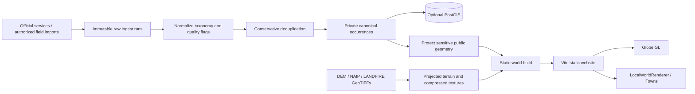

# Wildscape

A scientific habitat and species screening workspace with a separate 3D terrain and biodiversity explorer. Built with Vite, strict TypeScript, Globe.GL, iTowns and Three.js, with a Python GIS build pipeline and optional private PostGIS infrastructure.

**World 001 uses real USGS 3DEP terrain, NAIP imagery, LANDFIRE vegetation and GBIF biodiversity records.** Its approximately 15 km landscape was selected from official BpS 10820 raster coverage, with source verification documented in [docs/AOI_VERIFICATION.md](docs/AOI_VERIFICATION.md). A separate, clearly labeled `mojave-fixture` world provides deterministic offline testing. NatureServe enriches matching taxa with common names and conservation context before privacy protection.

Procedural vegetation represents a data-informed visualization, **not exact mapped plant locations**. Occurrence data represents recorded evidence, **not a complete inventory of all organisms living within the area**.

## Consultancy workspaces

The optional team workspace now provides accounts, owner/editor/viewer roles, shared server storage, invitations, revision history, conflict protection, password recovery and reversible archiving. Run `make local` to start both services, then open `http://127.0.0.1:5173/?workspace=1`. A fresh local installation offers first-workspace setup. See [SaaS operations](docs/SAAS_OPERATIONS.md) and the [release checklist](docs/MARKET_READINESS.md). Production containers are prepared; hosted operation and field validation are not yet complete.

## Screening workspace

The default route provides saved projects, polygon boundaries, uncertainty-aware species screening, LANDFIRE habitat summaries, field evidence, consultant review and GIS/CSV/printable report exports. Start with `make dev`. See [the screening operating guide](docs/SCREENING_GUIDE.md) for the first-project workflow, coverage limits, privacy and backups. The existing globe and terrain explorer is available at `/?explore=1` or through **3D context**.

The current screening pack covers one Mojave region and includes 670 CC0/CC BY records. Its browsable catalogue has 124 taxa with reusable records, grouped by taxonomy, with 120 locally cached, credited CC0/CC BY reference photos. Build or refresh these separately with `make species-media`. It is a local prototype requiring project-specific agency checks and professional field validation, not an automated regulatory assessment.

## Quick start

For the current app and Mojave point planner, run `make local` from the repository root. The planner is at `http://127.0.0.1:5173/?planner=mojave`. Keep that terminal open while using the app.

Requirements: Python 3.11+, Node 22.11+ (tested) and npm. Docker Desktop/Compose is needed for PostGIS tests, but not for the demo or deployed website. Allow several GB of free disk space for Python GIS wheels, browser tooling and database images. Rasterio includes the GDAL runtime needed by the pipeline; the GDAL command-line tools are optional.

```sh
cd '/path/to/user/Documents/01 Active Projects/GIS/WildScape'
make bootstrap
make demo
```

Open **http://127.0.0.1:5173/**. `make demo` rebuilds the deterministic fixture through raw ingestion, normalization, deduplication, privacy protection and static asset generation, then starts Vite. After setup, this fixture path needs no remote services. The globe's public-domain Natural Earth geometry and texture are bundled locally.

Already-built assets are included to `public/worlds/`. To view them without rebuilding:

```sh
make dev
```

In **3D context**, use **Explore** on the world card, then drag to orbit, right-drag to pan and scroll to zoom. The field guide supports search, taxonomy groups and historical/recent evidence views. Select a species to highlight its records, fit to observations, inspect a record and fly to it. Click terrain to query nearby public evidence, or use the keyboard-accessible **What’s been found here?** button to query the center of the view. Radius choices are 1, 2 and 5 km. Select World, Aerial, Vegetation, Elevation or Species without reloading the world. Use Data & sources for build provenance.

## Sun, terrain shadows and close-up imagery

Open **Sun & shadows** in a landscape and enable **Sun lighting**. Direction is azimuth clockwise from grid north; height is the sun angle above the horizon. The controls apply slope illumination (hillshade) and optional terrain cast shadows. Low angles produce longer shadows. The panel reports the modeled horizontal area and percentage in cast shadow, recomputed in a Web Worker.

Shadow analysis uses a bounded DEM grid (about 61 m sampling in World 001) and tests the terrain horizon toward the selected sun direction. It includes only ground within the loaded landscape. It excludes trees, buildings and terrain beyond the edge; it is not a survey-grade sunlight or solar-energy estimate. The sun angles are manual, not tied to date/time. NAIP photographs already contain lighting and shadows from their capture dates; this overlay cannot remove those original shadows.

World 001 now includes six levels of static 512-pixel imagery tiles, with a finest export spacing of approximately 0.96 m/pixel. iTowns selects visible tiles according to zoom; it does not load the whole pyramid at entry. Native aerial detail and acquisition dates vary. The elevation grid is 1,025 × 1,025 (about 15 m spacing), acquired from a finer 3DEP export. Further zoom beyond these source limits magnifies existing pixels and geometry.

To reacquire detail (successful NAIP patches are cached), rebuild assets, and package the site:

```sh
.venv/bin/python scripts/upgrade_detail.py
.venv/bin/wildscape build-world mojave-001
make build
```

The pyramid increases the total static download footprint on disk; only visible tiles are requested by the browser. Its acquisition responses stay private in `data_generated`, and only the tile images and metadata are copied to the public world. Sun settings and shadow area are transient browser state.

## Rebuild the real World 001

The included public assets can be served immediately. To reacquire official raster inputs for the verified configuration:

```sh
.venv/bin/wildscape fetch-terrain mojave-001
.venv/bin/wildscape fetch-landfire mojave-001 --endpoint https://edcintl.cr.usgs.gov/geoserver/landfire_wcs/conus_2016/wcs --coverage landfire_wcs:LF2016_BPS_CONUS --layer bps
.venv/bin/wildscape fetch-landfire mojave-001 --endpoint https://edcintl.cr.usgs.gov/geoserver/landfire_wcs/conus_2025/wcs --coverage landfire_wcs:LF2025_EVT_CONUS --layer evt
.venv/bin/wildscape fetch-landfire mojave-001 --endpoint https://edcintl.cr.usgs.gov/geoserver/landfire_wcs/conus_2025/wcs --coverage landfire_wcs:LF2025_EVC_CONUS --layer evc
.venv/bin/wildscape fetch-landfire mojave-001 --endpoint https://edcintl.cr.usgs.gov/geoserver/landfire_wcs/conus_2025/wcs --coverage landfire_wcs:LF2025_EVH_CONUS --layer evh
make all REGION=mojave-001
make build
```

This path uses the network and creates new immutable GBIF/enrichment runs. New source records may change the counts. The included build has 198 species, 910 records, 12 protected public locations, and 12,037 instanced vegetation models. Final raster coverage is 87.2% BpS 10820 across the roughly 15.7 × 15.7 km terrain bounds. The 1,025 × 1,025 elevation grid spans approximately 940–1728 m. Common names are enriched for 181 taxa and NatureServe conservation context is available for 179. No GBIF DOI is claimed for a search-API ingest; original requests and dataset identifiers are preserved.

## Architecture



The browser consumes only static public assets. It does not query GBIF, LANDFIRE, a raster service or PostGIS. Raster processing, taxonomy work, deduplication, sensitivity policy and vegetation placement happen in Python. The optional database is private build infrastructure.

- `worlds/`: world configuration and ecosystem model weights.
- `pipeline/wildscape/`: focused configuration, GIS, biodiversity, vegetation, database and public-build modules.
- `db/migrations/`: transparent PostGIS SQL.
- `fixtures/`: deterministic synthetic rasters and raw Darwin Core-style records.
- `data_raw/`: immutable ingest and optional enrichment runs; never served publicly.
- `data_generated/`: canonical/private intermediate data and temporary build stages; never served publicly.
- `public/worlds/`: the public manifest, terrain, vegetation, species, observation index, H3 aggregates, lazy occurrence details, attribution and checksums.
- `web/`: frontend and browser/unit tests.

### Rendering and coordinates

`LocalWorldRenderer` is the public interface. The default `ITownsWorldRenderer` uses a projected `PlanarView`, static `FileSource` elevation textures and color layers. iTowns supplies terrain tiling, geospatial coordinates and the render engine. Shared camera, vegetation and interaction code lives in `ThreeTerrainRenderer`; a complete direct Three.js renderer is available as an alternative implementation, but no fallback was necessary for either tested world.

iTowns uses easting/northing/elevation internally. An explicit root transform maps the app's local X/Y/Z axes into that frame:

- X = easting − origin easting
- Y = elevation − documented vertical origin
- Z = origin northing − northing

Python/PyProj and browser/Proj4 transformations have round-trip tests with a tolerance of 1e-8 degrees. Elevation sampling is bilinear. DEM vertices represent pixel centers; imagery is reprojected to exactly the terrain's vertex bounds. Meshes use meters, not stretched geographic degrees. No vertical datum conversion is implied.

The first elevation mesh is 33×33 in the fixture; the 129×129 version loads after mounting. A small initial texture is replaced by the full compressed texture. Wildlife uses batched points and H3 aggregation; details are fetched only when selected. Vegetation uses eight instanced model groups with camera-distance LOD. There are no independent meshes per observation or plant. Returning to Earth disposes the local renderer.

The dependency lock pins one Three.js version for Globe.GL and iTowns. Compatible Globe.GL renderer versions are explicitly pinned because mixing newer renderers with older geometry classes causes runtime errors. TypeScript resolves the installed `@itowns/geographic` declaration files instead of that package's source-code type export, which has upstream strict-check errors. App code remains strict.

## Database

```sh
make db-up
.venv/bin/wildscape all mojave-001 --database
make integration
make db-down
```

Compose uses the official `postgis/postgis:17-3.5-alpine` image, bound only to `127.0.0.1:55432`. On Apple Silicon, this image runs through Docker's amd64 emulation. `make db-down` preserves the volume. Credentials in `.env.example` are local development defaults, not production credentials.

The schema includes regions, ingest runs, immutable raw records, taxa and cross-references, occurrences, occurrence sources, media, conservation status, sensitive taxa, region associations and builds. Spatial GiST indexes and taxon/date/source indexes support private GIS analysis. Public and precise geometries are separate columns. A database trigger prevents updating or deleting raw records. CLI sync is idempotent for the same ingest run. No public database/API role is created.

### Environment

Copy `.env.example` if useful, then explicitly export desired values in your shell; the CLI does not silently load arbitrary environment files.

- `DATABASE_URL`: PostgreSQL connection string; defaults to the local Compose database.
- `NATURESERVE_API_KEY`: optional NatureServe credential if required by a deployment; public search worked without it during verification.
- `PLAYWRIGHT_CHANNEL`: optional browser override. On this Mac tests use installed Chrome; other machines default to Playwright Chromium installed by bootstrap.

No secrets belong in `VITE_*` variables or `public/`.

## Build World 001 from real data

**Do not turn off the fixture label while retaining the fixture footprint/data.** Establish a real BpS-dominated site first. World 001 now includes a verified AOI and downloaded official inputs; see `docs/AOI_VERIFICATION.md`. Follow this process for additional worlds.

1. Obtain an official LANDFIRE BpS raster and its release-specific raster attribute table (RAT). The raster `VALUE` is not necessarily the same as `BPS_CODE`. Find the VALUE IDs whose BPS_CODE is 10820.
2. Discover candidate windows from a projected raster in meters:

   ```sh
   .venv/bin/wildscape find-aoi --bps 10820 --size-km 15 \
     --raster data_raw/official-bps.tif --values VALUE_ID_1 VALUE_ID_2
   ```

   Replace `VALUE_ID_*` with numeric values from the official RAT. Candidates report BpS coverage; inspect their DEM relief and imagery coverage before selecting one. Relief ranking is not automatic in V1.
3. Copy `worlds/example/` to a new world directory (or edit World 001 deliberately), copy/adapt `ecosystem.yaml`, set a unique `id`, and configure `aoi.bbox: [west,south,east,north]` or `aoi.method: configured_polygon` with a GeoJSON `aoi.polygon`. Mark `aoi.verified: true` only after your review and set `fixture: false`.
4. Fetch official USGS terrain and imagery, or provide local GeoTIFF paths under `terrain.dem` and `terrain.imagery`:

   ```sh
   .venv/bin/wildscape validate-world YOUR_WORLD
   .venv/bin/wildscape fetch-terrain YOUR_WORLD
   ```

   The fetch command requests a coverage margin, a floating-point 3DEP TIFF and RGB NAIP TIFF. The pipeline validates CRS, NoData and full rectangular terrain coverage, projects to local UTM, resamples the DEM, and generates slope/aspect/hillshade/normals and WebP imagery. Use source files with extra perimeter coverage; missing DEM pixels fail explicitly rather than silently fabricating elevations. Source vertical units must be meters. The service mosaics required imagery before export; no giant orthophoto is sent to the browser.
5. Supply official BpS, EVT, EVC and EVH rasters under `vegetation.bps`, `evt`, `evc`, `evh`, or retrieve a configured WCS coverage:

   ```sh
   .venv/bin/wildscape fetch-landfire YOUR_WORLD \
     --endpoint OFFICIAL_WCS_URL --coverage OFFICIAL_COVERAGE_ID --layer bps
   ```

   Discover identifiers with the service's GetCapabilities and repeat for all four layers. Set `vegetation.bps_values`, `evc_mapping` (raster code → percent cover), `evh_mapping` (code → meters) using that release's official attribute tables. Optional `evt_weights` maps EVT codes to model weights. Missing LANDFIRE inputs omit 3D vegetation with a visible build warning. Unmapped categorical codes fail rather than treating codes as percentages/heights.
6. Configure sensitivity policy and optional enrichment, then build:

   ```sh
   .venv/bin/wildscape all YOUR_WORLD --database
   make build
   ```

   GBIF is the canonical occurrence backbone. API search is paginated at 300 records and fails above its 100,000-record ceiling; request an official DOI-bearing GBIF download for larger datasets. Import its Darwin Core CSV/TSV with `--input` and `--source gbif`. Store its DOI in `biodiversity.doi`. No full parallel iNaturalist/eBird corpus is blindly merged.

### Field imports and enrichment

`wildscape ingest WORLD --input FILE --source field` accepts a JSON array or UTF-8 CSV/TSV. Use Darwin Core names: `key`/`gbifID`/`id`/`occurrenceID`, `speciesKey` (or a canonical `acceptedTaxonKey`/`taxonKey`), `species`/`acceptedScientificName`/`scientificName`, `taxonRank`, `decimalLongitude`, `decimalLatitude`, `eventDate`, `basisOfRecord`, `license` and optional taxonomy/media/uncertainty fields. Map field names and canonical taxon identifiers explicitly before import. Raw submitted rows are retained unchanged. Name-only taxonomy resolution is not guessed offline; records without a canonical taxon identifier are excluded.

Then run normalize → enrich → dedupe → protect → build-world, or `wildscape all WORLD --input FILE --source field`. Every import gets its own immutable ingest run.

Optional world configuration:

```yaml
enrichment:
  natureserve: true
  protect_at_risk: true
  inaturalist: false
  # metadata_file: data_raw/authorized-taxon-metadata.json
  # usfws_layer: an official FeatureServer layer URL
  # usfws_name_field: the service's scientific-name column
  # usfws_status_field: the service's ESA-status column
```

`wildscape enrich WORLD` enriches normalized records. Exact-name NatureServe matches add conservation metadata with attribution. The optional precautionary policy generalizes G1/G2 or ESA E/T taxa; it is a project privacy rule, not a claim that NatureServe explicitly designates those coordinates as sensitive. An authorized metadata JSON array can contain `taxon_id`, `is_sensitive` and `conservation` entries. iNaturalist enriches only provider IDs already linked from the backbone and never imports more precise coordinates. USFWS uses a configured official GIS layer and documented field names. Remote enrichment failures produce warnings; they do not prevent an otherwise valid world. Responses remain in private immutable enrichment runs.

CNDDB has no scraper or automatic redistribution path. A future authorized importer can implement the source adapter contract and must pass the same privacy/export path.

## Data integrity and privacy

Raw → normalized → canonical → public are distinct stages. Normalization retains reported names, accepted identifiers, parent taxonomy, record type, uncertainty and transparent quality flags. Invalid coordinates, absent occurrences and geospatially problematic records do not enter the standard public build. Historical evidence remains available and distinct. Headlines count accepted species rank.

Deduplication merges only identical source IDs or a matching globally scoped original-provider identifier. Same species/date/location is not sufficient. Probable matches with additional event/collector evidence remain preserved and flagged. No claim is made that a record is a unique organism.

Source obscuration/generalization flags and configured sensitivity metadata trigger public protection. The default grid is at least 5 km in equal-area EPSG:6933; authoritative larger uncertainty remains respected. Public export uses a strict allowlist and removes raw payloads, precise fields, source record IDs/links for sensitive records, and sensitive record media. A generalized point can leave the AOI and is then explicitly flagged. These points can affect nearby query counts; the UI explains that limitation. Source links for ordinary publishable GBIF records remain visible.

No reverse engineering of obscured coordinates is performed. Do not put unauthorized precise data into the database. The automated privacy suite scans all public JSON for forbidden fields and checks generalized locations against private canonical geometry.

Media requires a configured permitted license (CC0, CC-BY or CC-BY-SA by default); attribution is mandatory for attribution-based licenses. Images are lazy-loaded. The fixture includes a CC0 synthetic habitat texture labeled as such, not a fabricated species photograph.

## Commands and validation

```sh
make bootstrap                 # local dependencies; no system package installation
make all REGION=mojave-fixture  # complete deterministic offline pipeline
make ingest REGION=mojave-001
make build-world REGION=mojave-001
make dev
make lint                      # Ruff and strict TypeScript
make test                      # Python GIS/data/build + Vitest
make db-up
make integration               # actual PostGIS + Playwright desktop/mobile
make build                     # static production output + gzip size report
```

`wildscape prepare-terrain WORLD` runs terrain/surface/vegetation processing separately. `wildscape db-sync WORLD` persists the latest normalized/canonical/public build state. `wildscape --help` lists commands.

Tests cover DEM footprints and CRS errors, coordinate round trips, terrain sampling, raw preservation, taxonomy, certain/cross-provider/probable deduplication, obscured geometry, public leakage scans, license filtering, deterministic vegetation, manifest counts/references/checksums, adapter paging, PostGIS immutability and browser interaction. Browser screenshots are written under `web/test-results/`.

## Production

Deploy **only `web/dist/`** to a static host after `make build`. Never deploy the repository root, `data_raw`, `data_generated`, `.env`, database volumes or source GeoTIFFs. No backend is required. Configure normal HTTP compression for JSON/JS/CSS. The generated example output is larger after the close-up imagery upgrade, including both real-world and fixture assets and dynamically loaded renderer chunks; the exact build-size report is printed on each build. Files over 5 MB trigger warnings.

Python versions are captured in `pipeline/requirements.lock`; frontend versions are locked in `web/package-lock.json`. Rebuild with the same configuration, seed and immutable input run to reproduce assets. Manifests include build version, time, ingest/config hashes, source dataset IDs and licenses. `checksums.json` records asset hashes.

## Verified sources and limits

Live API/service metadata checks succeeded for GBIF, USGS 3DEP, USGS NAIP and iNaturalist. An exact NatureServe query also succeeded. LANDFIRE WCS raster delivery and the real-data build now succeed. No USFWS layer was supplied, so its configurable adapter was not verified against a particular live schema. World 001 uses real data; `mojave-fixture` remains synthetic. Both pass the same build pipeline.

Primary source documentation:

- [GBIF occurrence API](https://techdocs.gbif.org/en/openapi/v1/occurrence)
- [USGS 3DEP ImageServer](https://elevation.nationalmap.gov/arcgis/rest/services/3DEPElevation/ImageServer)
- [USGS NAIP ImageServer](https://imagery.nationalmap.gov/arcgis/rest/services/USGSNAIPImagery/ImageServer)
- [LANDFIRE WCS/WMS](https://landfire.gov/data/lf_wcs_wms)
- [NatureServe Explorer API](https://explorer.natureserve.org/api-docs/)
- [iTowns documentation](https://www.itowns-project.org/itowns/docs/)
- [Natural Earth terms](https://www.naturalearthdata.com/about/terms-of-use/)

V1 limits: bounded local UTM worlds (no polar/dateline AOIs); full source coverage of the rectangular terrain context is required; no vertical datum conversion; no automatic DEM-relief ranking; no live production database; static observation summary indexes are intended for bounded world datasets; source privacy rules and release-specific LANDFIRE mappings still require data-owner review. Licensed media may use an external host, so optional media is not guaranteed offline. Fixture terrain is intentionally small and synthetic and cannot validate the ecological accuracy of a real Mojave landscape.
